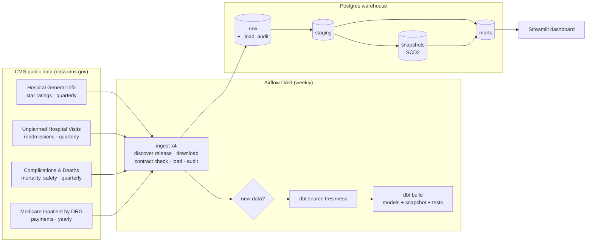

# Hospital Price & Quality Pipeline

**What does Medicare pay each hospital for the same procedure, and does paying more buy better care?**

A batch data pipeline that ingests public CMS (Centers for Medicare & Medicaid Services)
data every week, models it with **dbt** in a Postgres warehouse, orchestrates it with
**Apache Airflow**, tests it at every layer, and serves a **Streamlit** dashboard that
compares hospitals on price and quality side by side.

Runs on your laptop with Docker. Cost: **$0**. Data: public, no API key.

**Live demo:** _add your Streamlit Community Cloud link here_ (reads a published snapshot of the
pipeline's output tables; see [Public demo](#public-demo)).

---

## Why this matters

US hospital prices are famously opaque. The same procedure (a hip replacement, a heart
failure stay) can cost very different amounts at hospitals a few miles apart, and price
says little about quality. CMS publishes the numbers, but they're spread across separate
datasets with different formats, identifiers, release schedules and quirks.

This pipeline joins them into one trustworthy model that answers questions like:

- In my state, which hospitals are rated 4–5 stars **and** cost at or below the state median for this procedure?
- How wide is the price spread for the same procedure within a state?
- How has the cost of each procedure changed year over year?
- When did a hospital's star rating change? (CMS only publishes the *current* rating;
  this pipeline keeps the history.)

## Results (real CMS data, October 2026 run)

<!-- Screenshots: save them to docs/ and uncomment


-->

**Data loaded: 758,316 rows from 4 CMS datasets**

| Dataset | Release | Rows |
|---|---|---|
| Medicare inpatient payments by hospital & DRG | data years 2021–2024 | 590,037 |
| Complications and deaths | 2026-09-10 | 95,800 |
| Unplanned hospital visits (readmissions) | 2026-09-10 | 67,060 |
| Hospital general information | 2026-07-22 | 5,419 |

**Build:** `dbt build` passes 54 of 55 checks, with 1 intentional warning (below). A full build
takes ~9 s; an incremental rerun with no new data takes ~3 s and inserts 0 rows into the fact table.

**Findings**

- **Same procedure, different price.** For heart failure with major complications, the
  75th-percentile New York hospital (of 121) is paid **$17,776** per stay vs. **$11,796** at
  the 25th percentile: **51% more** for the same diagnosis group.
- **Good care isn't always expensive.** **926 hospitals** rated 4–5 stars are paid at or below
  their state median for at least one procedure group (the dashboard's *High value* segment).
- **Beware max/min ratios.** The raw max-to-min spread reaches 25–29× (e.g. coagulation
  disorders), but that's driven by a few extreme hospitals. Percentile ranges give a more
  honest picture, so the dashboard and the findings above use them.
- **Closed hospitals still bill.** 4,529 of 590,037 payment rows (0.8%) belong to hospitals no
  longer in CMS's current hospital list (closed or merged). The relationship test reports
  them as a warning instead of failing the build.

## Architecture



### Data model (dbt lineage)

```
raw.hospital_general_info ──► stg_cms__hospitals ──┬──► dim_hospital ─────────┐
                                                   └──► snap_hospitals (SCD2) ─► dim_hospital_history
raw.unplanned_hospital_visits ┐                                                │
raw.complications_deaths ─────┴► stg_cms__quality_measures ► int_hospital_quality_scores ┘
                                                                               ▼
raw.medicare_inpatient_drg ──► stg_cms__inpatient_drg ──► fct_inpatient_drg_payments (incremental)
                                                             ├─► mart_hospital_value   (price vs quality)
                                                             ├─► mart_state_drg_price_variation
                                                             └─► mart_drg_price_trend
```

| Model | Grain | What it answers |
|---|---|---|
| `dim_hospital` | hospital | Star rating, type, ownership, readmission rate, mortality vs. national |
| `dim_hospital_history` | hospital × version | SCD Type 2: every past rating/ownership with valid_from / valid_to |
| `fct_inpatient_drg_payments` | year × hospital × DRG | Payments + price index vs. state and national median (**incremental**) |
| `mart_hospital_value` | hospital × DRG (latest year) | Value segment: *High value*, *High quality, higher cost*, *Low value*, … |
| `mart_state_drg_price_variation` | year × state × DRG | Min / p25 / median / p75 / max and the max-to-min price spread |
| `mart_drg_price_trend` | year × DRG | National discharge-weighted payment and year-over-year change |

## Tech stack

| Skill | Where it's used |
|---|---|
| **Python** | Ingestion package: HTTP with retries, streaming downloads, CSV → Postgres COPY |
| **SQL** | All transformations: window functions, percentiles, CTEs, incremental logic |
| **dbt** | Sources + freshness, staging/intermediate/marts, incremental model, snapshot, macros, generic + singular + **unit tests**, docs |
| **Airflow** | Weekly DAG, task groups, retries with exponential backoff, short-circuit, params, failure callback |
| **Data modeling** | Kimball-style dimensions and facts, SCD Type 2, explicit grains |
| **Data quality** | Schema contracts at ingestion, 42 dbt data tests, 2 dbt unit tests, load audit table |
| **Postgres** | Warehouse; transactional loads, COPY, indexes |
| **Docker** | Whole platform in `docker compose` |
| **CI/CD** | GitHub Actions: lint, tests, end-to-end dbt build on fixtures, DAG integrity, image build |

## Quickstart

**Prerequisites:** Docker Desktop (4 GB+ RAM) and `make`. Windows: use WSL2.

```bash
make up        # builds images, starts Postgres, Airflow and the dashboard (~3–5 min first time)
```

| Service | URL | Login |
|---|---|---|
| Airflow | http://localhost:8080 | admin / admin |
| Dashboard | http://localhost:8501 | – |

### Option A: offline demo (1 minute, no internet needed)

```bash
make demo      # loads two simulated quarterly releases from tests/fixtures, runs dbt twice
```

Open the dashboard. The fixtures are small and synthetic but have the exact CMS file
layouts and the messy cases the pipeline has to handle.

### Option B: real CMS data

```bash
make reset     # clear demo data first
make run       # trigger the Airflow DAG (or press ▶ in the Airflow UI)
               # if CMS blocks a download, the log prints the link to open in a browser
               # and the exact landing/manual/... path to save it to
```

The first run downloads seven CSV files (the four yearly inpatient files are the
largest) and takes a few minutes. Downloads are kept in a Docker volume and reused. After that, the DAG runs every Monday,
and on weeks without a new CMS release it skips everything after ingestion.

Then explore:

```bash
make dbt cmd="build --select marts"     # rebuild marts
make docs                               # dbt docs + lineage graph on http://localhost:8081
docker compose exec postgres psql -U warehouse -d warehouse   # query the warehouse
```

Example query: the widest price spreads in the latest year:

```sql
SELECT state, drg_desc, hospitals, min_payment, max_payment, max_to_min_ratio
FROM marts.mart_state_drg_price_variation
WHERE data_year = (SELECT max(data_year) FROM marts.mart_state_drg_price_variation)
  AND hospitals >= 10
ORDER BY max_to_min_ratio DESC
LIMIT 10;
```

## Public demo

The live dashboard runs on Streamlit Community Cloud, which has no database. `make publish`
exports the two tables the dashboard reads (`mart_hospital_value`, `mart_drg_price_trend`)
from the warehouse to `app/data/*.parquet`, and the app queries those files with DuckDB
using the same SQL it runs against Postgres. Locally (in Docker) it still reads Postgres.
Refresh the demo after a pipeline run with `make publish`, then commit and push `app/data/`.

## Design decisions

**1. Ingestion is safe to re-run and safe to fail.**
Each load is a single Postgres transaction: delete that release's rows → `COPY` the
file → check the row count → commit. If a check fails, the transaction rolls back and
yesterday's data stays in place. A file that was already loaded (same release and
SHA-256) is skipped, so weekly runs are cheap and retries never duplicate rows. Every
attempt is recorded in `raw._load_audit` (rows, checksum, status, error).

**2. Schema contracts catch upstream changes at the door.**
Before touching the table, the loader checks the header against the columns the dbt
models depend on. If CMS renames or drops a required column, the run fails at
ingestion with a clear message instead of silently producing NULLs downstream. Two
kinds of drift are handled automatically:
- *Renamed columns* via aliases in `config/sources.yml` (older inpatient files call the
  CCN column `Rndrng_CCN`; newer ones `Rndrng_Prvdr_CCN`).
- *New columns* are added to the raw table (`ALTER TABLE ... ADD COLUMN`) and logged.

**3. New releases are discovered, not hard-coded.**
Quarterly datasets are resolved through the CMS Provider Data Catalog metastore API at
run time (latest CSV URL + `modified` date). The yearly inpatient files are pinned per
data year in config, which makes loads reproducible.

**4. Raw keeps everything as text; dbt staging does the typing.**
CMS mixes numbers with placeholders like `Not Available` and `Number of Cases Too
Small`. Loading everything as TEXT means a strange value never breaks ingestion;
staging macros (`to_numeric`, `clean_text`, `to_ccn`, `to_date_mdy`) convert values
explicitly and in one place.

**5. Identifiers are normalized.**
The CMS Certification Number (CCN) is a 6-character ID, but leading zeros get stripped
when files pass through spreadsheets ("050001" → "50001"), which silently breaks joins.
Staging left-pads every CCN, and a `valid_ccn` test enforces the format.

**6. Incremental fact table.**
`fct_inpatient_drg_payments` only reprocesses data years that were newly loaded or
reloaded (`delete+insert` on the unique key), and benchmarks are computed within a
year, so incremental runs produce the same result as a full rebuild. The
`assert_all_loaded_years_in_fact` test catches an incremental filter that skips a year.

**7. History that the source doesn't keep (SCD Type 2).**
CMS overwrites star ratings every quarter. A dbt snapshot runs after each load and
versions hospital attributes, so `dim_hospital_history` shows when each rating or
ownership change happened.

**8. Referential integrity as a warning, on purpose.**
Hospitals that closed or merged still appear in older billing data but not in the
current hospital list. Failing the build on that would block every run, so the
relationship test runs at `warn` severity: the gap is visible but not fatal.

**9. Skip work when nothing changed.**
A `ShortCircuitOperator` checks the ingest results; if no dataset had a new release,
the dbt tasks are skipped. Trigger with `{"force_reload": true}` to rebuild anyway.

**10. A fallback chain for blocked sources.**
On the first real run, data.cms.gov's bot protection returned `403` for the catalog API and
for direct CSV links on `data.cms.gov/provider-data`, while the inpatient files downloaded
fine. Rather than hard-fail, ingestion now tries three sources in order: catalog API →
pinned CSV link → a manual drop folder (`landing/manual/<dataset>/<release>.csv`). Whatever
the source, every file goes through the same contract checks, audit and idempotency.

**11. When a test fails on real data, find out why before changing it.**
The first build on real data failed a `not_negative` test on 3,774 quality-measure rows.
All of them were EDAC measures (*excess days in acute care*), which are measured against an
expected value and are legitimately negative when a hospital does better than expected.
The rule now exempts that measure family and still protects every other measure.

## Testing

| Layer | What | How to run |
|---|---|---|
| Unit (pytest) | Header normalization, contracts, release discovery, atomic downloads | `make test` |
| Loader integration | Idempotent reloads, rollback on bad files, aliases, new columns, encodings | `pytest` with `WAREHOUSE_HOST` set |
| dbt data tests (42) | Unique/not-null keys, CCN format, accepted values, non-negative amounts, Medicare ≤ total payment, every loaded year reaches the fact | `make dbt cmd=test` |
| dbt unit tests (2) | Value-segment rules; readmission measure selection | part of `dbt build` |
| End-to-end | Two releases → dbt build → asserts SCD2 history, incremental years, drift handling, idempotency | `make e2e` (**wipes the warehouse**) |
| DAG integrity | DAG imports, task wiring, retry settings | CI |

GitHub Actions runs all of it on every push, with a Postgres service container.

## Project structure

```
├── config/sources.yml          # datasets, required columns, aliases, row thresholds
├── ingest/                     # Python ingestion package
│   ├── sources.py              # release discovery + atomic downloads with retries
│   ├── contract.py             # header normalization + schema contract
│   ├── load.py                 # transactional COPY load, schema evolution, audit
│   ├── pipeline.py             # one dataset end to end (used by Airflow + CLI)
│   └── cli.py
├── dags/hospital_price_quality.py
├── dbt/
│   ├── models/{staging,intermediate,marts}/
│   ├── snapshots/snap_hospitals.sql
│   ├── macros/                 # cleaning helpers, schema naming
│   └── tests/                  # generic + singular tests
├── app/streamlit_app.py        # dashboard
├── tests/                      # pytest + fixture CSVs (+ generator)
├── scripts/e2e_fixtures.py     # end-to-end test
├── docker-compose.yml, Dockerfile.airflow, Makefile
└── .github/workflows/ci.yml
```

## Data sources

All public, from CMS:
- [Hospital General Information](https://data.cms.gov/provider-data/dataset/xubh-q36u)
- [Unplanned Hospital Visits – Hospital](https://data.cms.gov/provider-data/dataset/632h-zaca)
- [Complications and Deaths – Hospital](https://data.cms.gov/provider-data/dataset/ynj2-r877)
- [Medicare Inpatient Hospitals – by Provider and Service](https://data.cms.gov/provider-summary-by-type-of-service/medicare-inpatient-hospitals/medicare-inpatient-hospitals-by-provider-and-service)

"Total payment" includes Medicare's payment plus patient cost-sharing and other payers.
Hospitals with fewer than 11 Medicare discharges for a DRG are excluded (CMS suppresses
them). This is an analysis project, not medical or financial advice.

## Next steps

- Move the warehouse to **Snowflake** or **BigQuery** (dbt makes this mostly a profile change)
- Use **astronomer-cosmos** to render each dbt model as its own Airflow task
- Add the **Hospital Price Transparency** machine-readable files (negotiated commercial rates)
- **Terraform** + a cloud deployment (S3 landing zone, managed Airflow)

## Troubleshooting

| Symptom | Fix |
|---|---|
| Airflow UI not up after `make up` | First build takes a few minutes; `docker compose logs airflow-init` |
| Permission errors writing `dbt/target` (Linux) | `rm .env && make up` so `AIRFLOW_UID` matches your user |
| `403 Forbidden` from data.cms.gov | CMS bot protection (stricter on `data.cms.gov/provider-data`). The loader tries the catalog API, then pinned CSV links, then a **manual drop folder**: download the CSV in a browser and save it as `landing/manual/<dataset>/<YYYY-MM-DD>.csv` (inpatient: `<year>.csv`). The error message prints the exact link and path. |
| Ingest fails with "missing required columns" | CMS changed a file layout. The error lists the new columns; add an alias in `config/sources.yml` |
| Download fails for an inpatient year | CMS moved the file. Get the new CSV link from the dataset page and update `config/sources.yml` |
| Dashboard says "No data yet" | Run `make demo` or trigger the DAG |
